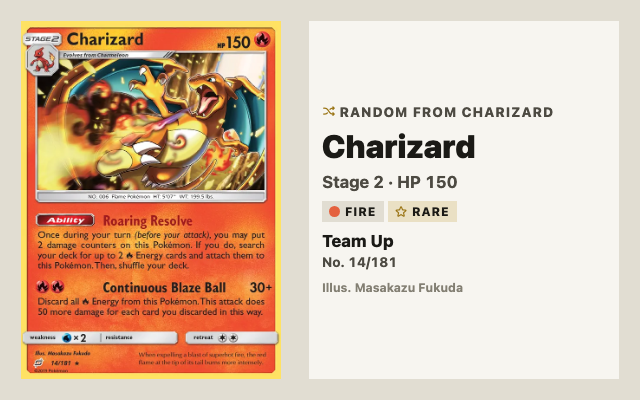

# Picture, Random Pokémon Card

A [Tesserae](https://github.com/dmellok/tesserae) widget that shows a random
Pokémon Trading Card Game card on an e-ink dashboard, read from
[TCGdex](https://tcgdex.dev/rest). No API key is needed.



## Options

| Option | What it does |
|---|---|
| **Pick from** | *Any card* (every card TCGdex has a scan of), *One series* (Base, Sword & Shield, Scarlet & Violet, …), or *One Pokémon* |
| **Series** | Shown for *One series*. The list comes from TCGdex, newest first |
| **Pokémon** | Shown for *One Pokémon*. Matches any card whose name contains it, so *Pikachu* also finds *Pikachu VMAX* and *Ash's Pikachu* |
| **Exact name only** | Shown for *One Pokémon*. Only cards named exactly that |
| **New card** | A fresh card on every refresh, or the same card for the hour or the day |
| **Show card details** | Medium and large cells only; turn off for the card alone |

| Size | What shows |
|---|---|
| xs, sm | The card alone, centred |
| md, lg | The card plus a details panel: where it was picked from, the name, stage and HP, type and rarity chips, the set and number, and the illustrator. Beside the card on a landscape cell, under it on a portrait one |

## Install

In Tesserae, open **Settings → Widgets → Browse** and install
*Picture, Random Pokémon Card*.

## How it works

TCGdex has a `/random/card` endpoint, but about one card in thirteen has no
scan, and a random pick that lands on one would leave the cell blank. So the
widget draws from a *pool*, a list of cards with every image-less card
dropped:

- **Any card.** `GET /v2/en/cards`, every card in one request (~2.4 MB).
- **One series.** `GET /v2/en/series/<id>` lists the series' sets with their
  card counts. A set is picked weighted by its count, so every card in the
  series is about equally likely, then `GET /v2/en/sets/<id>` gives its cards.
  Two requests instead of one per set.
- **One Pokémon.** `GET /v2/en/cards?name=<name>`.

The picked card's details come from `GET /v2/en/cards/<id>`, and its
`high.webp` scan (600×825, about 60 kB) is downloaded once and served from the
widget's own `/plugins/picture_pokemon/cards/` route, so the renderer reads it
over loopback. The newest 40 scans are kept.

**Caching.** Pools are cached for a day in the widget's data folder (a set's
card list for a week). If TCGdex can't be reached, the last pool is used, so an
offline host keeps turning up cards it has seen before. *Every hour* and *Every
day* seed the pick from the pool and the time, so the editor preview and the
panel agree on the card without any state being kept.

### Network and files

`plugin.json` declares, and Tesserae enforces, these hosts:

- `api.tcgdex.net` (card lists and details)
- `assets.tcgdex.net` (card scans)

The widget reads no settings and writes only inside its own data folder.

## Development

The widget follows the Tesserae
[widget contract](https://github.com/dmellok/tesserae/blob/main/docs/widgets.md).
Its tests run inside a Tesserae checkout. Copy or symlink this repo to
`plugins/picture_pokemon/` there, then run:

```sh
uv run pytest plugins/picture_pokemon/ -q
```

## Credits and licence

Card data and scans come from [TCGdex](https://tcgdex.dev). Pokémon and the
card artwork are © Nintendo, Creatures Inc. and GAME FREAK inc.; this widget is
not affiliated with or endorsed by them. The widget code is licensed under the
[GNU Affero General Public License v3.0](LICENSE).
